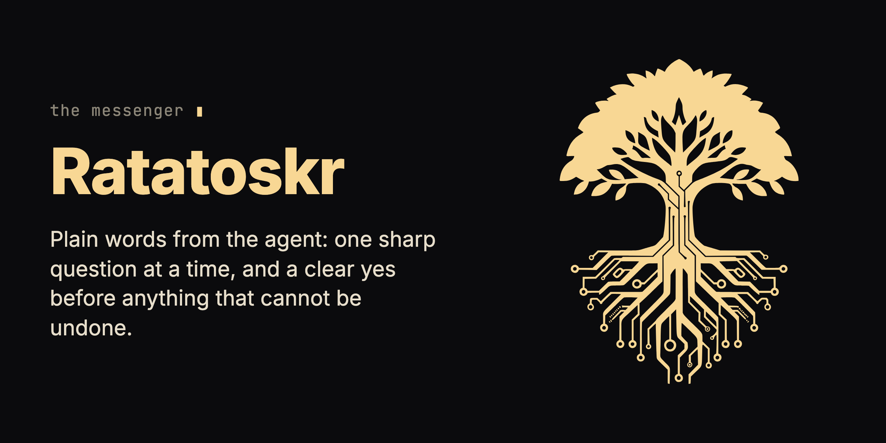

<p align="center"></p>

# Ratatoskr

**A translator between you and your codebase.** Ratatoskr changes how your coding agent talks to you: plain words about what changes in the product, never code, no invented timelines, and one clear yes before anything that can't be undone.

You ask for something in plain words, the agent answers in schemas, endpoints and "about two days", and you can't read the diff to check it built what you meant. You end up approving work you could not follow.

## What you install

In Claude Code:

```
/plugin marketplace add krzysztofdudek/RatatoskrSkill
/plugin install ratatoskr@ratatoskr-marketplace
```

Then run `/reload-plugins` or restart Claude Code. No config, no API key.

| Piece | Where it lands | What it does | When it acts |
|---|---|---|---|
| The Ratatoskr skill, one Markdown file ([`skills/ratatoskr/SKILL.md`](skills/ratatoskr/SKILL.md)) | your Claude Code plugins | Holds every rule of how the agent talks to you. | On every turn where the agent answers you about your codebase or product. |
| A session-start hook (`hooks/ratatoskr-session-start.sh`) | the plugin | Tells the agent to apply the skill from its first reply, and again after a context compaction. It carries no rules of its own. | At the start of every session. |

- **Never touches:** your repository, your git, the network, and how the agent does the work. It governs only what the agent says to you.
- **Needs:** an agent that reads skills; `bash` for the hook.
- **Costs:** no money and no key. Because the hook activates it in every session, the skill file (about 5,100 words) is part of the agent's context in every session.
- **In the agent's context:** one line from the hook at session start, then the skill body.

<details>
<summary>Other agents: GitHub Copilot CLI, Cursor, a plain skill folder</summary>

GitHub Copilot CLI:

```
copilot plugin marketplace add krzysztofdudek/RatatoskrSkill
copilot plugin install ratatoskr@ratatoskr-marketplace
```

Cursor:

```
git clone https://github.com/krzysztofdudek/RatatoskrSkill.git
ln -s "$(pwd)/RatatoskrSkill" ~/.cursor/plugins/local/ratatoskr
```

Then **Developer: Reload Window**.

A plain skill folder: copy [`skills/ratatoskr/SKILL.md`](skills/ratatoskr/SKILL.md) to `~/.claude/skills/ratatoskr/SKILL.md` (user level) or `.claude/skills/ratatoskr/SKILL.md` (project level), `~/.cursor/skills/ratatoskr/SKILL.md` for Cursor, or wherever your agent reads skills. A copied file comes without the session-start hook, so the agent applies it only when it decides the skill fits.

</details>

## What changes on the first day

- The agent talks about what a person using the product sees and does, not about code, even if you are technical or used the code word first.
- It gives no time or effort estimate in any form; it describes scope, names what is unknown, or works to a time-box you set.
- When your ask has two readings, it asks one question with the options and the default it would pick.
- Before anything permanent, such as deleting accounts, it names exactly what is lost and waits for one clear yes.
- A small, easy-to-undo ask stays a sentence or two.

## Start

1. Install with the two commands above, and start a new session.

   You see: the agent's first reply already in plain words.

2. Ask for a change in product terms: "add 'remember me' to the login page".

   You see: one question first, because the phrase has two readings.

   > **One thing first:** "remember me" can mean two different things. Which do you want?
   >
   > 1. Keep people signed in between browser sessions, so they don't re-enter their password every time (a checkbox on the login form).
   > 2. Just pre-fill the email field next time, but still ask for the password.
   >
   > I'd default to (1). Flag if not.

3. Answer "option 1".

   You see: a read-back before any work: what it thinks you asked for, what it would change and not change, who is affected, how easy it is to undo, any data notes, and how you check it afterwards in the product. It names the default it picked, such as a 30-day sign-in, so you can veto it.

## What it does not do

- It does not change what the agent builds or how; it governs only how the agent talks to you.
- It does not read your mind; the read-back is there so you can catch a misunderstanding.
- It reduces the risk of an irreversible step landing silently, and it cannot remove it if the agent fails to recognise a destructive step.
- It flags compliance surfaces (GDPR, PCI, HIPAA, accessibility) in plain terms and gives no legal advice.
- It has no memory between sessions, and it says so when you refer to one.

## Remove it

In Claude Code:

```
claude plugin uninstall ratatoskr@ratatoskr-marketplace
claude plugin marketplace remove ratatoskr-marketplace
```

On Copilot CLI, `copilot plugin uninstall ratatoskr@ratatoskr-marketplace`. On Cursor, delete the link in `~/.cursor/plugins/local/ratatoskr`. Uninstalling the plugin also removes the hook. Ratatoskr leaves nothing in your repository.

## Where it fits

Ratatoskr is an add-on of the family: it attaches to the agent, depends on no other family tool and keeps its own version.

Read more: [The skill](skills/ratatoskr/SKILL.md) · [Changelog](CHANGELOG.md) · [Report a problem](https://github.com/krzysztofdudek/RatatoskrSkill/issues)

## The Yggdrasil family

**[Jarl](https://github.com/krzysztofdudek/JarlSkill)** is the loop. **[Yggdrasil](https://github.com/krzysztofdudek/Yggdrasil)** is the law. **[Grain](https://github.com/krzysztofdudek/Grain)** is the survey. Those three are the core, and they ship under one version number, Jarl on it from 6.1.0: one set of tools built and tested against each other. Each of them works alone. Where a repository has a check, the check decides what lands in a Jarl loop: a fresh reviewer can only stop a change, never make a failing check pass, and its word is recorded as testimony. A Jarl loop in a repository with no check lands on testimony alone, and says so. Law that stays inside one component is raised freely by the agent working it. Law or decisions that reach a whole type of code are shared vocabulary: the agent proposes them and they run as advice at once, and the client — the one person the whole system answers to — admits them in one batch when the work closes. Only the client lowers or vetoes law. The core's shared machine contracts are registered on [one page](https://krzysztofdudek.github.io/Yggdrasil/family-contracts). The family is developed in the open in [Althing](https://github.com/krzysztofdudek/Althing): its releases, research and rulings.

Start at the step where it hurts.

| Where it hurts | Start with |
|---|---|
| More issues than one agent can hold in its head | **Jarl** |
| The agent keeps breaking what was agreed | **Yggdrasil** |
| Nobody knows what was agreed | **Grain**, which earns its keep the moment you are about to write law |

| Core | What it holds |
|---|---|
| **[Jarl](https://github.com/krzysztofdudek/JarlSkill)** | The loop. Everything seen becomes an issue, each issue gets one worker in its own worktree, nothing closes without evidence and a review, and no code closes without a fresh reviewer's word. Rulings keep their history, and a ruling about a whole type of code goes to the client in one batch when the loop closes. |
| **[Yggdrasil](https://github.com/krzysztofdudek/Yggdrasil)** | The law. The architecture graph, the rules over it and the log of why, checked before the agent moves on and re-proved in CI without a key. A rule that reaches a whole type runs as advice until the client ratifies it. |
| **[Grain](https://github.com/krzysztofdudek/Grain)** | The survey. Mines a repository's own code and history into a first graph — components, dependencies, and the rules the code already keeps, each with the count of places that break it today; Yggdrasil accepts it with one command. It measures and never blocks. |

Three add-ons attach to the agent rather than to the graph; each works alone, depends on nothing in the family and keeps its own version.

| Add-on | Stage | What it makes the agent prove |
|---|---|---|
| **Ratatoskr** (this one) | request → intent | Keeps the agent talking to you in plain words, not code, so you can follow what it's doing. |
| **[Urd](https://github.com/krzysztofdudek/UrdSkill)** | intent → code | When the spec is ambiguous, it consults the source of truth and asks, it doesn't guess. |
| **[Researcher](https://github.com/krzysztofdudek/ResearcherSkill)** | code → measured result | Point it at a metric and it runs experiments, hypotheses kept and discarded. |

## License

MIT. Made by [Krzysztof Dudek](https://github.com/krzysztofdudek).

---

<div align="center">
  
</div>
